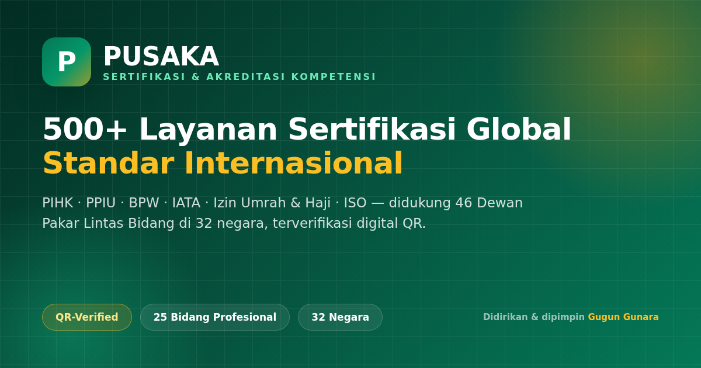
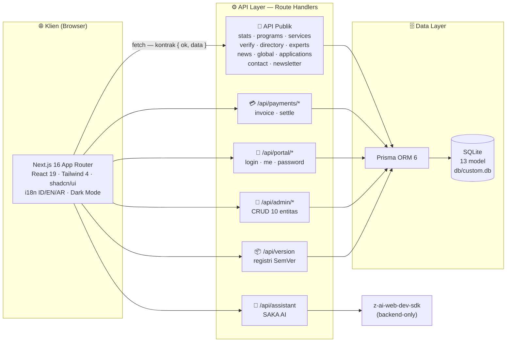
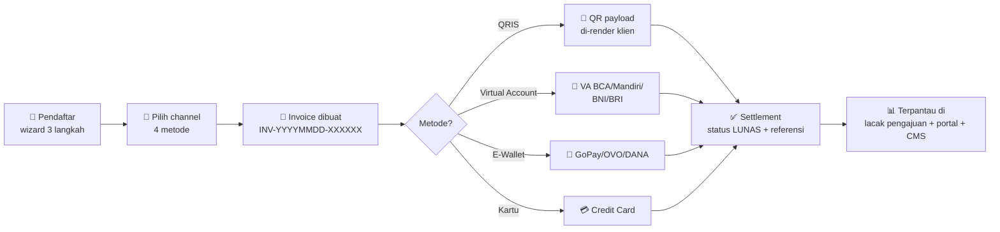
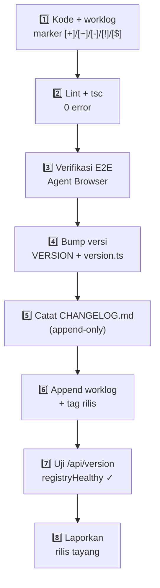

<div align="center">



# PUSAKA

### 🏛️ Pusat Sertifikasi & Akreditasi Kompetensi

**Lembaga Sertifikasi Profesi & Akreditasi Industri Perjalanan Wisata, Umrah & Haji**

[](CHANGELOG.md)
[](VERSIONING.md)
[](https://nextjs.org)
[](https://www.typescriptlang.org)
[](https://www.prisma.io)

[](https://tailwindcss.com)
[](https://ui.shadcn.com)
[](https://react.dev)
[](src/lib/i18n)
[](VERSIONING.md)

**[Tentang](#sec-tentang) · [Fitur](#sec-fitur) · [Program](#sec-program) · [Arsitektur](#sec-arsitektur) · [API](#sec-api) · [Memulai](#sec-mulai) · [Sistem Versi](#sec-versi) · [Pendiri](#sec-pendiri)**

</div>

---

## 📖 Daftar Isi

| | | |
|:---|:---|:---|
| [✨ Tentang PUSAKA](#sec-tentang) | [🌟 Fitur Unggulan](#sec-fitur) | [🧭 Program Sertifikasi](#sec-program) |
| [🌍 Jaringan Global](#sec-global) | [🤖 SAKA AI](#sec-saka) | [🛠️ Tech Stack](#sec-stack) |
| [🏗️ Arsitektur Sistem](#sec-arsitektur) | [📁 Struktur Proyek](#sec-struktur) | [🔌 API Referensi](#sec-api) |
| [🗃️ Model Data](#sec-data) | [🌐 Internasionalisasi](#sec-i18n) | [🔍 SEO & Discoverability](#sec-seo) |
| [💳 Payment Gateway](#sec-payment) | [👥 Portal Anggota](#sec-portal) | [🛡️ CMS Admin](#sec-cms) |
| [🚀 Memulai Cepat](#sec-mulai) | [📦 Sistem Kontrol Versi](#sec-versi) | [🧪 Kualitas & Pengujian](#sec-kualitas) |
| [🗺️ Roadmap](#sec-roadmap) | [👤 Pendiri & Ekosistem](#sec-pendiri) | [🤝 Kontribusi & Protokol](#sec-kontribusi) |

---

<a id="sec-tentang"></a>

## ✨ Tentang PUSAKA

> **PUSAKA** — *Pusat Sertifikasi & Akreditasi Kompetensi* — adalah platform digital terintegrasi untuk **sertifikasi profesi** dan **akreditasi lembaga** di industri perjalanan wisata, umrah, dan haji. Dari pendaftaran online, pembayaran multi-channel, asesmen oleh dewan pakar, hingga penerbitan sertifikat digital **QR-verified** — semuanya dalam satu sistem.

<div align="center">

| 🎓 | 🏢 | 🌍 | 👥 | 📦 | 🧾 | 🌐 | 🚀 |
|:---:|:---:|:---:|:---:|:---:|:---:|:---:|:---:|
| **14.840** | **24** | **32** | **46** | **500+** | **7** | **3** | **21** |
| Pemegang<br/>Sertifikat | Lembaga<br/>Terakreditasi | Negara<br/>Jaringan | Dewan<br/>Pakar | Layanan<br/>Sertifikasi | Program<br/>Resmi | Bahasa<br/>Antarmuka | Rilis<br/>Terstruktur |

</div>

### 🎯 Mengapa PUSAKA?

- ✅ **Resmi & Terstandar** — bekerja dengan acuan regulasi terkini (Kemenag, IATA, ISO/IEC 17024, KMA 569/2020)
- ✅ **Verifikasi Digital** — setiap sertifikat dapat diverifikasi publik dalam hitungan detik via nomor sertifikat + QR
- ✅ **Katalog Terlengkap** — 500+ layanan lintas **25 bidang profesional**, bukan hanya pariwisata
- ✅ **Triterra Bahasa** — Bahasa Indonesia, English, dan العربية dengan dukungan **RTL penuh**
- ✅ **Tata Kelola Modern** — sistem kontrol versi internasional (SemVer 2.0.0), changelog terbuka, ketertelusuran penuh
- ✅ **AI-Native** — asisten cerdas **SAKA** siap menjawab pertanyaan pengunjung 24/7

---

<a id="sec-fitur"></a>

## 🌟 Fitur Unggulan

<div align="center">

| | | |
|:---|:---|:---|
| 🏠 **Halaman Publik Naratif** | 📑 **11 Halaman Tersendiri Full-SEO** | 🔍 **Verifikasi Sertifikat Real-time** |
| Hero 3D-tilt, ticker Hijriah, animasi<br/>halus, dark mode ber-identitas | 6 halaman layanan + 5 halaman informasi,<br/>JSON-LD, sitemap, OG image | Cek nomor sertifikat instan + deep-link<br/>`?cert=` + log verifikasi |
| 💳 **Payment Gateway** | 👥 **Portal Anggota Lembaga** | 🛡️ **CMS Admin Lengkap** |
| QRIS, Virtual Account, E-Wallet,<br/>Kartu Kredit — invoice otomatis | Login pemegang sertifikat, dasbor<br/>pengajuan & pembayaran | CRUD 10 entitas + manajemen alur<br/>aplikasi + statistik live |
| 🤖 **SAKA AI** | 🌐 **Triterra i18n + RTL** | 📚 **Katalog 500 Layanan** |
| Asisten AI kontekstual PUSAKA<br/>mengambang, 3 bahasa | ID/EN/AR, format lokal otomatis,<br/>persistensi preferensi | Pencarian, filter kategori/skema/lingkup,<br/>facet & pagination |
| 📖 **Pusat Tutorial** | 📱 **PWA-Ready** | 📦 **Version Control Internasional** |
| 4 jalur panduan interaktif dengan<br/>kode demo salin-otomatis | Manifest, icon SVG, apple-web-app,<br/>theme-color emerald | SemVer 2.0.0 + Keep a Changelog,<br/>API versi mesin + lencana UI |

</div>

---

<a id="sec-program"></a>

## 🧭 Program Sertifikasi Resmi

Tujuh program utama — mencakup sertifikasi **profesi**, **perusahaan**, dan **izin resmi**:

| Kode | Program | Kategori | Durasi | Investasi | Cakupan |
|:---|:---|:---:|:---:|---:|:---|
| <kbd>PIHK</kbd> | Pendamping Haji Khusus | Profesi | 30 hari | Rp 2.450.000 | Haji & umrah nasional |
| <kbd>PPIU</kbd> | Perusahaan Perjalanan Umrah | Perusahaan | 45 hari | Rp 7.950.000 | Penyelenggara umrah |
| <kbd>BPW</kbd> | Biro Perjalanan Wisata | Perusahaan | 40 hari | Rp 6.500.000 | Pariwisata umum |
| <kbd>BPW-PRO</kbd> | BPW Profesional | Profesi | 21 hari | Rp 1.850.000 | Kompetensi individu BPW |
| <kbd>IATA</kbd> | Sertifikasi IATA | Perusahaan | 60 hari | Rp 12.500.000 | Agen tiket internasional |
| <kbd>IJIN-UMRAH</kbd> | Izin Umrah | Izin Resmi | 90 hari | Rp 15.000.000 | Legalitas penyelenggara |
| <kbd>IJIN-HAJI</kbd> | Izin Haji | Izin Resmi | 120 hari | Rp 35.000.000 | Legalitas PIHK |

> 💡 Setiap program kini memiliki **halaman resmi tersendiri full-SEO** — akses via `#/p/layanan/pihk`, `#/p/layanan/ppiu`, dst., atau lewat dropdown **Halaman** di navbar.

---

<a id="sec-global"></a>

## 🌍 Jaringan Global (32 Negara)

PUSAKA beroperasi lintas benua melalui **33 node global** — kantor perwakilan dan mitra internasional:

| Wilayah | Kehadiran | Contoh Fokus |
|:---|:---:|:---|
| 🕌 Timur Tengah | ✅ | Arab Saudi (Makkah & Jeddah), Uni Emirat Arab, Qatar |
| 🌏 Asia Tenggara | ✅ | Indonesia (HQ), Malaysia, Singapura, Thailand |
| 🌏 Asia Selatan | ✅ | India, Pakistan, Bangladesh |
| 🌏 Asia Timur | ✅ | Jepang, Korea Selatan, Tiongkok |
| 🌍 Eropa | ✅ | Inggris, Belanda, Jerman, Turki |
| 🌍 Afrika | ✅ | Mesir, Maroko, Afrika Selatan, Nigeria |
| 🌎 Amerika | ✅ | Amerika Serikat, Kanada |
| 🌏 Oseania | ✅ | Australia |

Setiap program membawa peta cakupan negaranya sendiri (`Program.countries`), ditampilkan pada dialog detail program dan halaman resmi.

---

<a id="sec-saka"></a>

## 🤖 SAKA AI — Asisten Cerdas

**S**istem **A**dvokasi & **K**onsultasi **A**utomatis — asisten AI mengambang yang memahami konteks PUSAKA:

| Aspek | Detail |
|:---|:---|
| 🧠 Mesin | `z-ai-web-dev-sdk` dijalankan **khusus di backend** (`/api/assistant`) |
| 🗣️ Bahasa | Menjawab dalam bahasa yang sedang aktif (ID/EN/AR) |
| 🎯 Konteks | Memahami program, persyaratan, alur pendaftaran, verifikasi, harga |
| 🎨 Antarmuka | Panel chat mengambang, riwayat sesi, tombol saran pertanyaan |

---

<a id="sec-stack"></a>

## 🛠️ Tech Stack

| Lapisan | Teknologi | Peran |
|:---|:---|:---|
| **Framework** | Next.js 16 · App Router | Rute modern, metadata API, file-based SEO routes |
| **Bahasa** | TypeScript 5 · strict | Type-safety menyeluruh, nol `any` di kode proyek |
| **UI** | React 19 · shadcn/ui (New York) | 48+ komponen aksesibel berbasis Radix |
| **Styling** | Tailwind CSS 4 · tw-animate | Design token, utilitas logis RTL (`ps-`/`pe-`) |
| **Ikon** | Lucide React | Ikon konsisten seluruh antarmuka |
| **Animasi** | Framer Motion | Fade-in bertahap, transisi halus |
| **State** | Zustand · TanStack Query | State klien & server yang terpisah rapi |
| **Database** | Prisma 6 · SQLite | 13 model, query type-safe, seed deterministik |
| **Auth** | Sesi cookie · scrypt | Hash `salt:hash`, rate-limit login in-memory |
| **AI** | z-ai-web-dev-sdk | SAKA AI (backend-only) |
| **Font** | Plus Jakarta Sans · Geist Mono | Identitas tipografi + kode |
| **Palet** | Emerald 🟢 + Gold 🟡 | Identitas premium; **tanpa indigo/blue** |

---

<a id="sec-arsitektur"></a>

## 🏗️ Arsitektur Sistem



### Kontrak API Resmi

Setiap route — tanpa kecuali — mengembalikan bentuk yang sama:

```jsonc
// Sukses
{ "ok": true, "data": { /* ... */ } }

// Gagal
{ "ok": false, "error": "Pesan kesalahan yang jelas" }
```

Semua route dinamis memakai `export const dynamic = "force-dynamic"` + `Cache-Control: no-store` — data selalu segar, kontrak selalu konsisten.

---

<a id="sec-struktur"></a>

## 📁 Struktur Proyek

<details open>
<summary><b>🌳 Pohon direktori (klik untuk lipat)</b></summary>

```text
pusaka/
├── 📄 VERSION                      # Sumber kebenaran versi → "6.1.1"
├── 📄 CHANGELOG.md                 # Mirror manusia 21 rilis (Keep a Changelog)
├── 📄 VERSIONING.md                # Standar tata kelola versi (SemVer 2.0.0)
├── 📄 worklog.md                   # Log kerja per task (Protokol Worklog v2)
│
├── prisma/
│   ├── schema.prisma               # 13 model data
│   ├── seed.ts                     # Seed deterministik (re-run aman)
│   └── data/
│       ├── services.ts             # Generator katalog 500 layanan (FNV-1a)
│       └── globalNodes.ts          # 33 node / 32 negara
│
├── db/
│   └── custom.db                   # Database SQLite aktif
│
├── public/
│   ├── og-image.png                # Banner Open Graph 1200×630
│   ├── icon.svg · logo.svg         # Identitas visual
│   └── images/                     # Aset berita & hero (AI-generated)
│
└── src/
    ├── app/
    │   ├── layout.tsx              # Metadata SEO lengkap + JSON-LD @graph
    │   ├── page.tsx                # Halaman utama + router deep-link
    │   ├── globals.css             # Token tema Emerald–Gold (light + dark)
    │   ├── sitemap.ts              # → /sitemap.xml (11 entri)
    │   ├── robots.ts               # → /robots.txt (+Sitemap)
    │   ├── manifest.ts             # → /manifest.webmanifest (PWA)
    │   └── api/                    # 13 grup · 30+ endpoint (lihat API Referensi)
    │
    ├── components/
    │   ├── pusaka/                 # 34 komponen publik (navbar, hero, programs…)
    │   │   ├── pages/              # 6 modul halaman tersendiri full-SEO
    │   │   └── admin/              # 12 panel CMS (dashboard, CRUD, login)
    │   └── ui/                     # 48 komponen shadcn/ui
    │
    ├── hooks/                      # use-mobile, use-toast
    │
    └── lib/
        ├── version.ts              # ⭐ Registri versi — sumber kebenaran SemVer
        ├── site.ts                 # Konstanta situs (URL, SEO, kontak)
        ├── pusaka.ts               # Tipe kontrak + fetcher + formatter i18n
        ├── pages/registry.ts       # Registri 11 halaman tersendiri
        ├── use-page-seo.ts         # SEO dinamis per halaman (+MutationObserver)
        ├── use-hash-route.ts       # Router deep-link #/p/...
        ├── auth.ts · rate-limit.ts # Sesi admin & portal + throttle
        ├── payment-methods.ts      # Katalog channel pembayaran
        ├── db.ts                   # Prisma client singleton
        └── i18n/
            ├── provider.tsx        # I18nProvider + useI18n() + ?lang=
            └── dict/               # 37 namespace × 3 bahasa (ID/EN/AR)
                └── pages/          # Kamus 11 halaman tersendiri
```

</details>

---

<a id="sec-api"></a>

## 🔌 API Referensi Lengkap

### 🌍 API Publik

| # | Method | Endpoint | Deskripsi |
|:---:|:---:|:---|:---|
| 1 | `GET` | `/api/stats` | Statistik agregat: total, distribusi program & tier, aktivitas terkini |
| 2 | `GET` | `/api/programs` | 7 program sertifikasi lengkap (syarat, manfaat, harga, negara) |
| 3 | `GET` | `/api/services` | Katalog 500 layanan — `?q=` `&category=` `&scheme=` `&scope=` `&page=` `&pageSize=` + facet |
| 4 | `GET` | `/api/directory` | Direktori lembaga — `?q=` `&type=` `&tier=` (urut tier) |
| 5 | `GET` | `/api/experts` | 46 dewan pakar lintas 9 bidang keilmuan |
| 6 | `GET` | `/api/news` | Berita & pengumuman resmi |
| 7 | `GET` | `/api/global` | Jaringan 32 negara + ringkasan per wilayah |
| 8 | `POST` | `/api/verify` | Verifikasi sertifikat (case-insensitive) + catat `VerifyLog` |
| 9 | `POST` | `/api/applications` | Daftar program (zod-validated) → kode unik `PSK-YYYY-XXXXX` |
| 10 | `GET` | `/api/applications?code=` | Lacak pengajuan: riwayat status + status pembayaran |
| 11 | `POST` | `/api/contact` | Kirim pesan ke sekretariat |
| 12 | `POST` | `/api/newsletter` | Berlangganan buletin (dedup email) |
| 13 | `POST` | `/api/assistant` | 🤖 SAKA AI — percakapan kontekstual (backend-only SDK) |
| 14 | `GET` | `/api/version` | 📦 Registri versi — `?type=` `&limit=` `&q=` + meta self-audit |

### 💳 Pembayaran

| Method | Endpoint | Deskripsi |
|:---:|:---|:---|
| `GET` | `/api/payments/methods` | Katalog channel: QRIS, VA (BCA/Mandiri/BNI/BRI), E-Wallet (GoPay/OVO/DANA), Kartu |
| `POST` | `/api/payments` | Buat invoice `INV-YYYYMMDD-XXXXXX` (VA number / QR payload) |
| `POST` | `/api/payments/:id/settle` | Simulasi settlement (mode demo) |
| `GET` | `/api/payments?trackingCode=` | Daftar invoice satu pengajuan |

### 👥 Portal Anggota · 🛡️ CMS Admin

| Grup | Endpoint | Deskripsi |
|:---|:---|:---|
| **Portal** | `POST /api/portal/login` · `logout` · `me` · `change-password` | Login pemegang sertifikat + dasbor (pengajuan, pembayaran, profil) |
| **Auth CMS** | `POST /api/auth/login` · `logout` · `GET /api/auth/me` | Sesi admin (scrypt + cookie + rate-limit) |
| **Admin CRUD** | `/api/admin/{programs, institutions, experts, news, applications, verify-logs, global-nodes, messages, newsletter, stats}` | 10 resource — masing-masing `GET` koleksi + `POST/PATCH/DELETE` `[id]` |

> 📡 **Contoh — cek versi sistem:**
>
> ```bash
> curl -s http://localhost:3000/api/version | jq '{name:.data.name, version:.data.current.version, codename:.data.current.codename, healthy:.meta.registryHealthy}'
> # → { "name": "PUSAKA", "version": "6.1.1", "codename": "Codex", "healthy": true }
> ```

---

<a id="sec-data"></a>

## 🗃️ Model Data (13 Tabel)

| Model | Fungsi | Kolom Kunci |
|:---|:---|:---|
| `Program` | 7 program sertifikasi | `code` unik, `category`, `price`, `countries` (JSON) |
| `Service` | 500 layanan global | `code` SVC-0001…0500, `categorySlug`, `scheme`, `scope` |
| `Institution` | Lembaga terakreditasi | `certNumber` unik, `tier` SILVER/GOLD/PLATINUM, `score` |
| `Expert` | 46 dewan pakar | `category` (9 bidang), `licenseNo` unik, `experienceYears` |
| `Application` | Pengajuan sertifikasi | `trackingCode` PSK-YYYY-XXXXX, `status` (5 tahap), `paymentStatus` |
| `Payment` | Invoice pembayaran | `invoiceNo`, `method`, `vaNumber`/`qrPayload`, `status` |
| `GlobalNode` | 33 node jaringan | `kind` KANTOR/MITRA, `countryCode`, `region`, `scope` |
| `VerifyLog` | Log verifikasi publik | `certNumber`, `result` VALID/INVALID |
| `NewsArticle` | Berita resmi | `slug` unik, `category`, `publishedAt` |
| `MemberAccount` | Akun portal anggota | `email` unik, 1:1 `Institution` |
| `AdminUser` | Akun CMS | `username`, `role` SUPERADMIN/STAFF |
| `NewsletterSubscriber` | Pelanggan buletin | `email` unik, `isActive` |
| `ContactMessage` | Pesan masuk | `handled` (penanganan) |

**Alur status pengajuan:** `SUBMITTED → REVIEW → VERIFIKASI → ASSESSMENT → APPROVED`
**Alur status pembayaran:** `MENUNGGU → BERHASIL | GAGAL | KADALUARSA`

---

<a id="sec-i18n"></a>

## 🌐 Internasionalisasi (i18n)

| Aspek | Implementasi |
|:---|:---|
| 🗣️ **Bahasa** | 🇮🇩 Indonesia (kanonik) · 🇬🇧 English · 🇸🇦 العربية |
| 🧩 **Arsitektur** | `I18nProvider` + `useI18n()` — 37 namespace kamus × 3 bahasa |
| ↔️ **RTL** | `html[dir=rtl]` + utilitas logis Tailwind (`ps-`, `pe-`, `border-s-`) + `rtl:rotate-180` untuk ikon arah |
| 💱 **Format lokal** | `Intl.NumberFormat` / `DateTimeFormat` per locale — mata uang, tanggal, waktu relatif |
| 💾 **Persistensi** | `localStorage("pusaka-lang")` — aman dari race-condition mount (fix v6.0.1) |
| 🔗 **Parameter URL** | `?lang=en|ar` — prioritas di atas localStorage (untuk hreflang & crawler, tanpa menimpa preferensi) |

---

<a id="sec-seo"></a>

## 🔍 SEO & Discoverability

Arsitektur SEO menyeluruh (rilis **v6.1.0 "Lighthouse"**):

| Elemen | Detail |
|:---|:---|
| 🏷️ **Metadata** | `metadataBase`, title/description/keywords, `canonical` per halaman |
| 🌐 **Hreflang** | `id` · `en` · `ar` · `x-default` |
| 🤖 **Robots** | Directive `googleBot`: `max-image-preview:large`, `max-snippet:-1` |
| 📄 **11 Halaman Tersendiri** | 6 layanan (`pihk`, `ppiu`, `bpw`, `iata`, `izin-umrah`, `izin-haji`) + 5 informasi (`tentang`, `kontak`, `faq`, `kebijakan-privasi`, `syarat-ketentuan`) |
| 🧬 **JSON-LD** | `@graph` **Organization + WebSite + ProfessionalService** (server-rendered) + per-halaman **Service**, **FAQPage**, **BreadcrumbList** |
| 🗺️ **Sitemap** | `/sitemap.xml` — 11 entri deep-link dengan prioritas |
| 📱 **PWA** | `/manifest.webmanifest` · `/icon.svg` · `appleWebApp` · `themeColor #047857` |
| 🖼️ **Open Graph** | OG image 1200×630 + Twitter Card `summary_large_image` |
| 🔬 **SEO Runtime** | `usePageSeo` terpusat + `MutationObserver` pengaman (title tidak tertimpa runtime head) |

---

<a id="sec-payment"></a>

## 💳 Payment Gateway



| Metode | Channel | Biaya Layanan |
|:---|:---|:---|
| 📱 QRIS | Semua e-money & m-banking | Dinamis per channel |
| 🏦 Virtual Account | BCA · Mandiri · BNI · BRI | Per bank |
| 📲 E-Wallet | GoPay · OVO · DANA | Per penyedia |
| 💳 Kartu Kredit | Visa · Mastercard | Per channel |

> Status pembayaran tersinkron ke **tiga titik**: halaman lacak pengajuan, portal anggota, dan CMS admin.

---

<a id="sec-portal"></a>

## 👥 Portal Anggota Lembaga

Pemegang sertifikat memiliki akun eksklusif yang terikat 1:1 dengan lembaganya:

| Fitur | Detail |
|:---|:---|
| 🔐 Login aman | scrypt `salt:hash` + cookie sesi |
| 📊 Dasbor | Profil lembaga + tier + skor audit + masa berlaku sertifikat |
| 📋 Pengajuan | Semua pengajuan lembaga + status real-time |
| 💳 Pembayaran | Riwayat invoice + bayar langsung dari portal |
| 🔑 Keamanan | Ganti password mandiri |

---

<a id="sec-cms"></a>

## 🛡️ CMS Admin PUSAKA

Panel kontrol internal — diakses via tombol diskret di footer:

| Modul | Kemampuan |
|:---|:---|
| 📈 Dashboard | Statistik live: pengajuan, verifikasi, pertumbuhan lembaga |
| 🧭 Programs | CRUD 7 program (syarat, manfaat, harga, kuota, negara) |
| 🏢 Institutions | CRUD lembaga + tier + skor audit |
| 👨‍🏫 Experts | CRUD 46 pakar + kategori keilmuan |
| 📰 News | CRUD berita (Markdown editor) |
| 📋 Applications | Manajemen alur status 5 tahap + integrasi pembayaran |
| 🔍 Verify Logs | Audit seluruh aktivitas verifikasi publik |
| 🌍 Global Nodes | CRUD jaringan 32 negara |
| ✉️ Messages | Kotak pesan kontak + status penanganan |
| 📮 Newsletter | Manajemen pelanggan buletin |

---

<a id="sec-mulai"></a>

## 🚀 Memulai Cepat

### Prasyarat


### Instalasi

```bash
# 1️⃣ Instal dependensi
bun install

# 2️⃣ Siapkan environment
echo 'DATABASE_URL=file:/home/z/my-project/db/custom.db' > .env

# 3️⃣ Push skema + seed data (7 program · 24 lembaga · 46 pakar · 500 layanan · 32 negara)
bun run db:push
bunx prisma db seed        # atau: bun prisma/seed.ts

# 4️⃣ Jalankan server pengembangan
bun run dev                # → http://localhost:3000
```

### Skrip

| Perintah | Fungsi |
|:---|:---|
| `bun run dev` | Server pengembangan (port 3000) + log ke `dev.log` |
| `bun run lint` | ESLint 9 — audit kualitas kode |
| `bun run build` | Build produksi (standalone) |
| `bun run start` | Jalankan hasil build produksi |
| `bun run db:push` | Push `schema.prisma` → SQLite |
| `bun run db:generate` | Regenerasi Prisma Client |
| `bun run db:migrate` / `db:reset` | Migrasi / reset database |

### 🔑 Akun Demo

<details>
<summary><b>Lihat kredensial demo (data seed)</b></summary>

| Peran | Kredensial | Keterangan |
|:---|:---|:---|
| 🛡️ CMS Superadmin | `admin` / `Pusaka2026!` | Akses penuh seluruh modul |
| ✏️ CMS Editor | `editor` / `Editor2026!` | Akses staf |
| 👥 Portal Anggota | `finance@zahratour.co.id` / `pusaka123` | PT Zahra Tour Indonesia — PLATINUM |
| 👥 Portal Anggota | `admin@amanahnusantara.co.id` / `pusaka123` | PT Amanah Nusantara Wisata |
| 👥 Portal Anggota | `corp@tic.co.id` / `pusaka123` | PT Tour Indonesia Cahaya (TIC) |
| 👥 Portal Anggota | `contact@garudaoriente.co.id` / `pusaka123` | PT Garuda Oriente Trans |

</details>

### 🧾 Kode Contoh untuk Dicoba

| Kode | Coba di | Hasil |
|:---|:---|:---|
| `PPU-2025-0001` | 🔍 Verifikasi cepat | PT Zahra Tour Indonesia — **PLATINUM** |
| `BPW-2025-0102` | 🔍 Verifikasi cepat | Lembaga BPW terakreditasi |
| `IAT-2025-0201` | 🔍 Verifikasi cepat | Holder sertifikasi IATA |
| `PSK-2025-83012` | 📋 Lacak pengajuan | Riwayat status 5 tahap + pembayaran |
| `SVC-0001`…`SVC-0500` | 📚 Katalog layanan | Detail 500 layanan |

---

<a id="sec-versi"></a>

## 📦 Sistem Kontrol Versi

PUSAKA menerapkan tata kelola rilis berstandar internasional — **[SemVer 2.0.0](https://semver.org)** + **[Keep a Changelog 1.1.0](https://keepachangelog.com)**. Standar lengkap: **[VERSIONING.md](VERSIONING.md)**.

### Cara Membaca Versi

```text
   v  9  .  1  .  2
      │     │     └── PATCH — perbaikan bug, tanpa fitur baru
      │     └──────── MINOR — fitur baru yang kompatibel ke belakang
      └────────────── MAJOR — perubahan besar / tidak kompatibel
```

### 🚂 Release Train — 21 Rilis Terstruktur

| Versi | Jenis | Codename | Rilis | Ringkasan |
|:---|:---:|:---|:---:|:---|
| **6.1.1** | PATCH | **Codex** | 📍 berjalan | Dokumentasi README desain penuh |
| 6.1.0 | MINOR | Lighthouse | | 11 halaman tersendiri + infrastruktur SEO penuh |
| 6.0.1 | PATCH | Lingua | | Perbaikan persistensi bahasa + rebrand PUSAKA |
| 6.0.0 | MAJOR | Sentinel | | Sistem kontrol versi SemVer 2.0.0 |
| 5.1.1 | PATCH | Concord | | Konsolidasi katalog & stabilitas |
| 5.1.0 | MINOR | Polymath | | Branding pendiri + jaringan ekosistem |
| 5.0.0 | MAJOR | Pustaka | | Katalog 500 layanan + pusat tutorial |
| 4.2.1 | PATCH | Anchor | | Integrasi final paket digital |
| 4.2.0 | MINOR | Vault | | Payment gateway pendaftaran |
| 4.1.0 | MINOR | Keyholder | | Portal anggota lembaga |
| 4.0.0 | MAJOR | Polyglot | | Mesin tri bahasa ID/EN/AR + RTL |
| 3.1.1 | PATCH | Beacon | | Integrasi 7 fitur digital |
| 3.1.0 | MINOR | Spectra | | QR sertifikat · ticker Hijriah · newsletter |
| 3.0.0 | MAJOR | Oracle | | SAKA AI + dark mode penuh |
| 2.1.1 | PATCH | Prism | | Perbaikan z-index shell CMS |
| 2.1.0 | MINOR | Atlas | | Jaringan global 32 negara |
| 2.0.0 | MAJOR | Citadel | | CMS admin + autentikasi |
| 1.2.1 | PATCH | Kronos | | Konsistensi waktu relatif |
| 1.2.0 | MINOR | Panorama | | 18 komponen UI publik + 5 aset AI |
| 1.1.0 | MINOR | Meridian | | Sembilan API publik pertama |
| 1.0.0 | MAJOR | Genesis | | Fondasi platform + identitas visual |

> 🏷️ Setiap rilis menyimpan **ketertelusuran Task ID** ke `worklog.md` dan dapat di-query mesin.

### Alur Rilis (8 Langkah)



### 🌐 API Versi untuk Mesin

```bash
# Semua rilis (default limit 20)
curl "http://localhost:3000/api/version"

# Filter + cari
curl "http://localhost:3000/api/version?type=minor&limit=5"
curl "http://localhost:3000/api/version?q=seo"

# Respons memuat self-audit kesehatan registri
# meta: { registryHealthy: true, semverValid: true, matched: n }
```

---

<a id="sec-kualitas"></a>

## 🧪 Kualitas & Pengujian

| Gerbang | Alat | Kriteria |
|:---|:---|:---|
| 🔍 Static analysis | ESLint 9 · `eslint-config-next` | **0 error · 0 warning** |
| 🧠 Type check | `tsc --noEmit` · strict | **0 error** di seluruh kode proyek |
| 🖥️ E2E Manual | Agent Browser | Seluruh alur utama diuji: verifikasi, pendaftaran, pembayaran, portal, CMS, i18n 3 bahasa, RTL, dark mode, mobile 390px |
| 📡 Kontrak API | curl / jq | Bentuk `{ ok, data }` + status code tervalidasi per endpoint |
| ♻️ Seed | `prisma/seed.ts` | Deterministik & aman re-run (hash FNV-1a) |

---

<a id="sec-roadmap"></a>

## 🗺️ Roadmap

- [x] 🏛️ Fondasi platform — skema, seed, identitas visual (v1.0.0)
- [x] 🌐 Triterra i18n + RTL penuh (v4.0.0)
- [x] 💳 Payment gateway end-to-end (v4.2.0)
- [x] 📦 Sistem kontrol versi internasional (v6.0.0)
- [x] 🔍 11 halaman tersendiri full-SEO (v6.1.0)
- [x] 📖 README dokumentasi desain penuh (v6.1.1)
- [ ] 🔔 Notifikasi email otomatis (status pengajuan & invoice)
- [ ] 📱 PWA installable penuh + offline cache
- [ ] 🖨️ Cetak sertifikat PDF dengan tanda tangan digital
- [ ] 🌍 Halaman per-negara dari 32 jaringan global
- [ ] 👤 Profil publik per-dewan-pakar (46 halaman)
- [ ] 📊 Analitik CMS dengan ekspor laporan

---

<a id="sec-pendiri"></a>

## 👤 Pendiri & Ekosistem

<div align="center">

# GUGUN GUNARA

**Master Polymath** · **Sage Universal** · **The Ultimate Problem Solver**

*Pendiri & Pemimpin PUSAKA*

[](https://gunara.web.id)
[](https://pusatperizinan.com)
[](https://gohajj.web.id)

</div>

> *"Tiga situs ekosistem, satu visi: perizinan dan jasa haji yang berintegritas."*

| Situs | Fokus |
|:---|:---|
| 🌐 [gunara.web.id](https://gunara.web.id) | Kepemimpinan inovasi & konsultasi strategis |
| 📋 [pusatperizinan.com](https://pusatperizinan.com) | Pusat layanan perizinan usaha terpadu |
| 🕋 [gohajj.web.id](https://gohajj.web.id) | Platform jasa perjalanan haji & umrah |

### 📮 Kontak Resmi

| | |
|:---|:---|
| 🏢 Alamat | Gedung Pusdai Lt. 5, Jl. Lapangan Banteng Selatan No. 3, Jakarta Pusat 10710 |
| ✉️ Email | sekretariat@pusaka.go.id |
| ☎️ Telepon | +62 21 350 5075 |

---

<a id="sec-kontribusi"></a>

## 🤝 Kontribusi & Protokol Worklog v2

Setiap perubahan pada repositori ini **wajib** mengikuti protokol terdokumentasi:

1. 📖 Baca **[VERSIONING.md](VERSIONING.md)** — standar SemVer 2.0.0 + kaidah bump
2. 📝 Baca **[worklog.md](worklog.md)** terlebih dahulu — pahami apa yang sudah dikerjakan agen sebelumnya
3. 🔧 Kerjakan perubahan dengan marker kategori: `[+]` ditambah · `[~]` diubah · `[-]` dihapus · `[!]` diperbaiki · `[$]` keamanan
4. 🚂 Ikuti **alur rilis 8 langkah** (lihat diagram di atas) — bump versi + catat changelog + append worklog
5. ✅ Pastikan `bun run lint` bersih dan E2E alur utama lulus sebelum melapor selesai

> ⚖️ **Append-only**: entri `CHANGELOG.md` dan `worklog.md` tidak boleh ditulis ulang — riwayat adalah warisan.

---

<a id="sec-dokumentasi"></a>

## 📜 Dokumentasi Terkait

| Dokumen | Isi |
|:---|:---|
| 📘 [VERSIONING.md](VERSIONING.md) | Standar normatif versi: format, kaidah bump, alur rilis, tata kelola, konsumsi API |
| 📗 [CHANGELOG.md](CHANGELOG.md) | Mirror manusia 21 rilis dengan marker kategori |
| 📙 [worklog.md](worklog.md) | Log kerja per Task ID — ketertelusuran penuh pengembangan |
| 📦 [VERSION](VERSION) | Angka versi berjalan — `6.1.1` |
| 🔌 `GET /api/version` | Endpoint mesin untuk monitoring & otomasi CI |

---

<div align="center">

```text
██████╗ ██╗   ██╗███████╗ █████╗ ██╗  ██╗ █████╗
██╔══██╗██║   ██║██╔════╝██╔══██╗██║ ██╔╝██╔══██╗
██████╔╝██║   ██║███████╗███████║█████╔╝ ███████║
██╔═══╝ ██║   ██║╚════██║██╔══██║██╔═██╗ ██╔══██║
██║     ╚██████╔╝███████║██║  ██║██║  ██╗██║  ██║
╚═╝      ╚═════╝ ╚══════╝╚═╝  ╚═╝╚═╝  ╚═╝╚═╝  ╚═╝
        Pusat Sertifikasi & Akreditasi Kompetensi
```

**PUSAKA v6.1.1 "Codex"** · Dirilis dengan ❤️ dan standar internasional

© PUSAKA — Pusat Sertifikasi & Akreditasi Kompetensi · Didirikan & dipimpin **Gugun Gunara**

</div>
